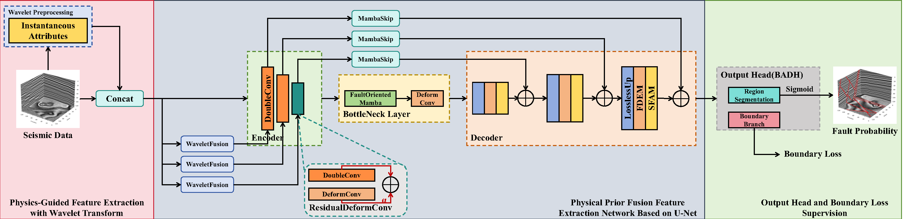
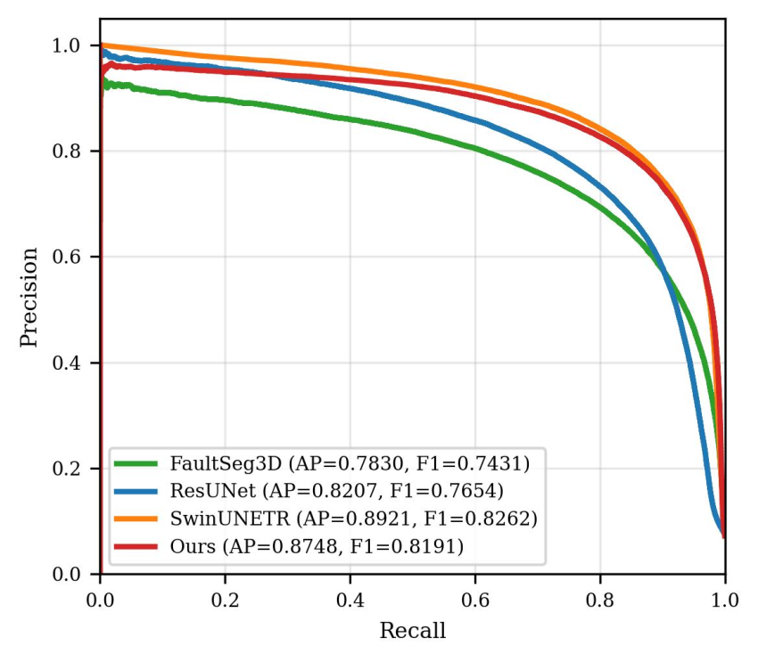
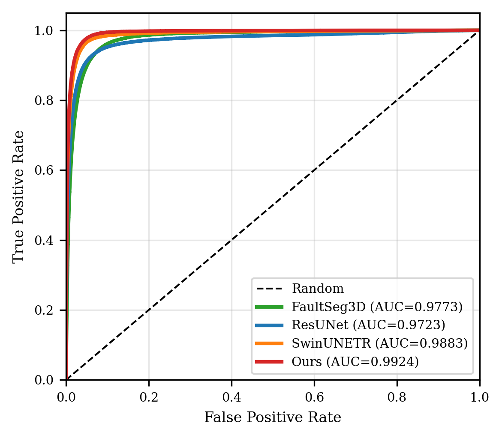
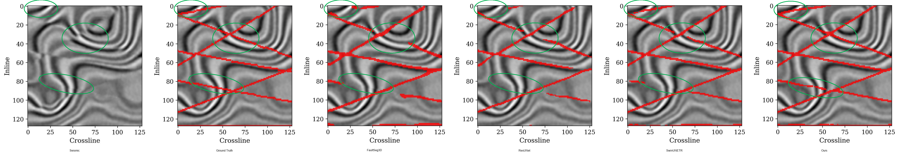
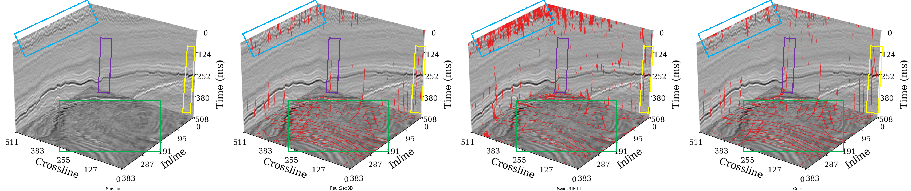
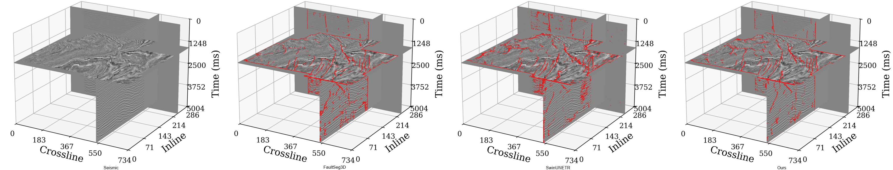
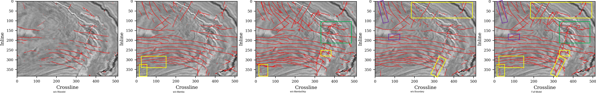

<div align="center">

# WaveSSM: An Enhanced Mamba-UNet with Wavelet-Domain Multi-scale Physical Priors for Seismic Fault Detection

[]()
[](./LICENSE)
[]()
[]()
[]()

*Under review at **Geophysics** (2026)*

</div>

## Overview

Seismic fault detection supports subsurface interpretation by locating discontinuities in 3D seismic volumes. CNN-based methods can struggle to connect faults over long distances, and many models use only the seismic amplitude volume without its derived attributes.

WaveSSM (Wavelet State Space Model) combines three components:

1. **Wavelet-domain seismic-attribute priors.** CWT-derived amplitude gradient, local incoherence, and local variance are computed at five scales. Together with the original input, they form a 16-channel representation. In this repository, "prior" refers to geophysically meaningful attribute information rather than a constraint derived from the wave equation.

2. **Mamba-based long-range modeling.** A Mamba state-space module aggregates global context with linear asymptotic sequence complexity. Measured runtime still depends on the implementation, kernels, and hardware.

3. **Boundary-aware supervision.** A region and boundary prediction head is trained with region and boundary losses to improve fault edges and continuity.

The model has 3.33 million trainable parameters. The reported experiments include quantitative evaluation on synthetic data and qualitative transfer tests on the public F3 and Kerry3D field datasets.

<p align="center">
  <em>Model architecture overview. See the paper for full details.</em>
</p>

## Model architecture

WaveSSM-UNet uses a U-shaped encoder-decoder with three component groups:

| Component | Description |
|-----------|-------------|
| **Wavelet-Domain Attribute Extraction** | CWT-based front-end that computes five-scale amplitude-derived attributes and forms a 16-channel input. |
| **Mamba-Enhanced U-Net** | Encoder with `ResidualDeformConv` blocks and `WaveletFusion` modules; Bottleneck centered around `FaultOrientedMamba` for tri-directional bidirectional scanning; Decoder with `LosslessUp` (pixel-shuffle) upsampling, `FDEM` (Fault Detail Enhancement Module), `SFAM` (`SeismicFaultCBAM` in the implementation), and `MambaSkip` connections. |
| **Boundary-Aware Decoupled Head (BADH)** | Splits prediction into a region branch and a boundary branch, supervised by Dice, Focal, and a dedicated boundary loss term. |

### Core modules

- **ResidualDeformConv:** deformable convolutions for curved and tilted fault geometries
- **WaveletFusion:** fusion of wavelet-domain attributes at the first two encoder stages
- **FaultOrientedMamba:** bidirectional scanning along the depth, inline, and crossline coordinates with learned directional weights; the module does not estimate fault strike or dip
- **MambaSkip:** Mamba-based skip connections that pass multi-directional context from the encoder to the decoder
- **LosslessUp:** channel-to-space rearrangement followed by learnable refinement; the rearrangement is bijective, while the complete module is not strictly lossless
- **FDEM:** Laplacian-guided local contrast processing for fine fault details
- **SFAM** (`SeismicFaultCBAM` in code): variance-aware channel and spatial attention

<p align="center">
  
  <br><em>Figure 1: Overview of the WaveSSM-UNet model architecture.</em>
</p>

## Design summary

- Mamba-based context modeling with linear asymptotic sequence complexity and 3.33 million parameters, compared with 62.19 million for the tested SwinUNETR configuration
- Multi-scale wavelet-domain attributes computed from the seismic input
- Region and boundary supervision for thin or discontinuous fault labels
- Evaluation on the synthetic validation set and qualitative transfer to F3 and Kerry3D
- A 50-volume training experiment for the limited-data setting

## Requirements

### Environment

Use the pinned environment specification, then install Mamba SSM after PyTorch:

```bash
conda env create -f environment.yml
conda activate wavessm
pip install mamba-ssm==2.2.2 --no-build-isolation
```

For a smaller manual installation:

```bash
# Create and activate conda environment (recommended)
conda create -n wavessm python=3.10
conda activate wavessm

# Install PyTorch (CUDA 11.8)
pip install torch==2.1.2 torchvision==0.16.2 --index-url https://download.pytorch.org/whl/cu118

# Install Mamba SSM
pip install mamba-ssm>=2.2.0

# Install remaining dependencies
pip install -r requirements.txt
```

### Core dependencies

| Package | Version | Purpose |
|---------|---------|---------|
| PyTorch | ≥2.1 | Deep learning framework |
| mamba-ssm | ≥2.2.0 | State space model backbone |
| NumPy | ≥1.21, <2.0 | Numerical computation |
| SciPy | ≥1.7 | Scientific computing |
| MONAI | ≥1.3.0 | Medical/volumetric image utilities |
| scikit-learn | ≥1.0 | Evaluation metrics |
| Matplotlib | ≥3.4 | Visualization |
| OpenPyXL | ≥3.0 | Excel report generation |

### Hardware

- **GPU**: NVIDIA RTX 4080 SUPER or equivalent (≥16 GB VRAM recommended)
- **RAM**: ≥32 GB system memory
- **Storage**: ≥50 GB free disk space for datasets

## Quick start

### Training

Train WaveSSM-UNet from scratch on synthetic data:

```bash
python main.py \
    --mode train \
    --exp wavessm_experiment \
    --model_type msm_unet \
    --train_path /path/to/train/data/ \
    --valid_path /path/to/validation/data/ \
    --epochs 200 \
    --batch_size 2 \
    --optim_lr 1e-4 \
    --optimizer adamw \
    --lr_scheduler none \
    --loss_func bce+dice \
    --boundary_loss_weight 0.3 \
    --use_ema False \
    --early_stop_patience 20
```

Key training arguments:

| Argument | Default | Description |
|----------|---------|-------------|
| `--model_type` | `msm_unet` | Model selection: `msm_unet`, `FAULTSEG3D`, `RESUNET`, `RESACEUNET`, `SWINUNETR` |
| `--loss_func` | `bce+dice` | Composite region-loss mode; the current `bce+dice` path uses Dice + Focal terms (BCE is retained for compatibility) |
| `--optimizer` | `adamw` | Optimizer: `adam`, `adamw` |
| `--lr_scheduler` | `none` | LR schedule: `none`, `cosine`, `warmup_cosine` |
| `--use_ema` | `False` | Exponential moving average of weights |
| `--early_stop_patience` | `20` | Early stopping patience (validation steps) |
| `--grad_accum_steps` | `1` | Gradient accumulation steps |
| `--boundary_loss_weight` | `0.3` | Weight for boundary loss term |
| `--fp16` | `False` | FP16 inference (saves VRAM) |

### Released pretrained checkpoint

The released WaveSSM-UNet checkpoint is included at
[`checkpoints/WaveSSM_UNet_BEST.pth`](https://github.com/YiheyanZhang/WaveSSM_UNet/blob/main/checkpoints/WaveSSM_UNet_BEST.pth).
The training code keeps the historical `MSM_UNet_BEST.pth` name for newly
created experiment directories; the released file uses the WaveSSM-specific
name to avoid confusion with the baseline models.

To validate or predict with the released checkpoint, place it in the model
directory of an experiment and pass its filename explicitly:

```bash
mkdir -p EXP/wavessm_release/models
cp checkpoints/WaveSSM_UNet_BEST.pth EXP/wavessm_release/models/

python main.py \
    --mode valid_only \
    --exp wavessm_release \
    --model_type msm_unet \
    --valid_path /path/to/validation/data/ \
    --pretrained_model_name WaveSSM_UNet_BEST.pth
```

### Validation only

Evaluate a trained model on validation data:

```bash
python main.py \
    --mode valid_only \
    --exp wavessm_experiment \
    --model_type msm_unet \
    --valid_path /path/to/validation/data/ \
    --pretrained_model_name MSM_UNet_BEST.pth
```

### Prediction

Run inference with sliding window and Gaussian blending:

```bash
python main.py \
    --mode pred \
    --exp wavessm_experiment \
    --model_type msm_unet \
    --pretrained_model_name MSM_UNet_BEST.pth \
    --pred_data_name f3 \
    --overlap 0.5 \
    --threshold 0.5 \
    --sigma 0.0 \
    --use_sliding_window True
```

Prediction targets (`--pred_data_name`): `f3`, `kerry`, `thebe`

### Reproducing baseline comparisons

Train and evaluate baseline models for comparison:

```bash
# FaultSeg3D (CNN baseline)
python main.py --mode train --exp baseline_faultseg3d --model_type FAULTSEG3D ...

# ResUNet (CNN baseline)
python main.py --mode train --exp baseline_resunet --model_type RESUNET ...

# ResACEUnet
python main.py --mode train --exp baseline_resaceunet --model_type RESACEUNET ...

# SwinUNETR (Transformer baseline)
python main.py --mode train --exp baseline_swinunetr --model_type SWINUNETR ...
```

Use `--train_ratio` and `--split_seed` for data efficiency ablation studies:

```bash
# Train with only 25% of training data (for data efficiency experiments)
python main.py --mode train --train_ratio 0.25 --split_seed 42 ...
```

The CIG-Bench comparison uses the public `cig-bench==0.2.0` package. Installation, training, evaluation, and field-data inference commands are documented in [`docs/AUTODL_CIG_BENCH.md`](docs/AUTODL_CIG_BENCH.md).

## Datasets

### Download

The training, validation, and field-data inputs are available through Baidu Wangpan:

| Contents | Samples | Directory |
|----------|---------|-----------|
| Training set | ~200 | `train/` |
| Validation set | ~20 | `validation/` |
| F3 real seismic data | N/A | `prediction/f3/` |
| Kerry3D real seismic data | N/A | `prediction/kerry3d/` |

> **Download link**: [Baidu Wangpan](https://pan.baidu.com/s/15m7RWQxu86C6Ej3-9RSUoQ), extraction code: `ju47`
>
> 220 samples total (train + validation). F3 and Kerry3D prediction data are in the `prediction/` subdirectory.

### Original sources for field data

| Dataset | Source | Description |
|---------|--------|-------------|
| **Netherlands F3** | [TerraNubis](https://terranubis.com/datainfo/F3-Demo-2023) (dGB Earth Sciences) | Public 3D seismic survey, North Sea |
| **Kerry3D** | [SEG Wiki](https://wiki.seg.org/wiki/Kerry-3D) / [AWS Open Data](http://s3.amazonaws.com/open.source.geoscience/open_data/newzealand/Taranaki_Basin/Keri_3D/Kerry3D.segy) | Public 3D seismic survey, Taranaki Basin, New Zealand |

### Data preprocessing

All datasets should be preprocessed before training:
1. Convert `.dat` / `.segy` to `.npy` format
2. Apply Z-score normalization (zero mean, unit variance)

## Experimental results

### Synthetic data: full training set (200 volumes)

The table reports results from the full synthetic-data experiment:

| Model | Params | mIoU ↑ | Dice ↑ | F1 ↑ | ROC-AUC ↑ | PR-AUC ↑ |
|-------|--------|--------|--------|------|-----------|----------|
| FaultSeg3D | N/A | 0.7775 | 0.8624 | 0.7462 | 0.9773 | 0.7877 |
| ResUNet | N/A | 0.7988 | 0.8796 | 0.7805 | 0.9727 | 0.8395 |
| SwinUNETR | 62.19 M | 0.8438 | 0.9094 | 0.8313 | 0.9878 | 0.8957 |
| **WaveSSM-UNet (Ours)** | **3.33 M** | **0.8607** | **0.9203** | **0.8517** | **0.9924** | **0.9107** |

<p align="center">
  
  
  <br><em>PR and ROC curves on the full synthetic validation set (200 training samples).</em>
</p>

### Synthetic data: 50-volume training subset

This experiment uses 50 synthetic volumes, or 25% of the full training set:

| Model | mIoU ↑ | Dice ↑ | F1 ↑ | ROC-AUC ↑ | PR-AUC ↑ |
|-------|--------|--------|------|-----------|----------|
| SwinUNETR | 0.7255 | 0.8219 | 0.6821 | 0.9561 | 0.7208 |
| **WaveSSM-UNet (Ours)** | **0.8148** | **0.8893** | **0.7945** | **0.9757** | **0.8458** |

The result is consistent with the wavelet-domain attributes providing additional fault-related cues when training data are limited. It does not establish that the attributes alone prevent overfitting.

### Synthetic-data examples

<p align="center">
  <em>2D slice at Depth = 50. Comparison of all models on synthetic data.</em><br>
  
</p>

### F3 field data (Netherlands North Sea)

The models were trained on synthetic data and applied to the F3 volume without fine-tuning.

<p align="center">
  <em>3D fault prediction results on the F3 dataset (Netherlands North Sea).</em><br>
  
</p>

### Kerry3D field data (Taranaki Basin, New Zealand)

<p align="center">
  <em>3D fault prediction results on the Kerry3D dataset (Taranaki Basin, New Zealand).</em><br>
  
</p>

### Ablation study

Ablation experiments assess the contribution of the main component groups:

| Configuration | Effect |
|---------------|--------|
| w/o Wavelet Priors | Degraded generalization, increased noise sensitivity |
| w/o FaultOrientedMamba | Reduced fault continuity, fragmented predictions |
| w/o MambaSkip | Loss of fine structural detail in decoder |
| w/o Boundary Loss | Blurred fault edges, reduced boundary sharpness |

<p align="center">
  <em>Ablation study on the F3 dataset. Removing a main component group degrades the corresponding continuity or boundary quality. The full model (rightmost) combines all groups.</em><br>
  
</p>

*Full ablation study: see Figures 23 and 24 in the paper.*

## Project structure

```
WaveSSM/
├── main.py                  # Entry point: training, validation, prediction
├── cig_bench_experiment.py  # CIG-Bench training, evaluation, prediction
├── environment.yml          # Tested software environment
├── models/                  # Model definitions
│   ├── wavelet_analyze.py   # CWT-based seismic-attribute extraction
│   └── faultseg3d.py        # WaveSSM-UNet + Mamba modules
├── compare_models/          # Baseline model implementations
│   ├── build.py             # Model factory
│   ├── ResUnet.py           # ResUNet
│   ├── UNet3.py             # 3D UNet
│   ├── ResACEUnet.py        # ResACEUNet
│   └── SwinUNETR.py         # SwinUNETR (Transformer baseline)
├── dataloader/              # Data loading pipeline
├── utils/                   # Training, evaluation, and utility functions
│   ├── train.py             # Training loop + EMA + early stopping
│   ├── test.py              # Sliding window prediction + metrics
│   ├── tools.py             # Helper utilities
│   ├── dice_loss.py         # Loss functions
│   └── segmentation_metrics.py
├── configs/                 # Configuration files
├── scripts/                 # Ablation and comparison scripts
│   ├── losslessup_audit.py
│   ├── reviewer1_phase1.py
│   └── run_ratio_ablation.sh
├── tests/                   # Metric and tensor-operation checks
├── C3/                      # C3 coherence algorithm
├── generate_cig_bench_figures.py
├── generate_paper_figures.py
├── plot_pr_roc_compare.py   # PR/ROC curve plotting
├── requirements.txt
└── LICENSE
```

## Citation

If you use WaveSSM in your research, please cite our work:

```bibtex
@article{zhang2026wavessm,
  title   = {An Enhanced Mamba-UNet with Wavelet-Domain Multi-scale Physical
             Priors for Seismic Fault Detection},
  author  = {Yiheyan Zhang and Yajun Tian and Jinghuai Gao},
  journal = {Geophysics},
  year    = {2026},
  note    = {Under review}
}
```

## Attribution

This repository uses code or data from the following projects and public datasets:

- **FaultSeg3D:** [Xinming Wu et al. (2019)](https://github.com/xinwucwp/faultSeg), synthetic training data and the original fault-segmentation framework
- **FaultSeg3D_pytorch:** [Chaofan Ke (Ifjmww)](https://github.com/Ifjmww/FaultSeg3D_pytorch), the PyTorch codebase used as the starting point for this repository
- **ResACEUnet:** [Chaofan Ke](https://github.com/39c5bb-miku/ResACEUnet), baseline implementations of SwinUNETR and ResUNet
- **CIG-Bench:** [Yimin Dou et al.](https://github.com/douyimin/CIG-bench), the public fault-segmentation checkpoint and HRNet implementation
- **Netherlands F3 dataset:** [dGB Earth Sciences](https://terranubis.com/datainfo/F3-Demo-2023), a public 3D seismic survey
- **Kerry3D dataset:** New Zealand Crown Minerals, via [SEG Wiki](https://wiki.seg.org/wiki/Kerry-3D) and [AWS Open Data](http://s3.amazonaws.com/open.source.geoscience/open_data/newzealand/Taranaki_Basin/Keri_3D/Kerry3D.segy)

If you use or reference this code in your project, we appreciate an attribution statement:

```text
Parts of this code are based on modifications of Ifjmww's FaultSeg3D_pytorch.
Original project link: https://github.com/Ifjmww/FaultSeg3D_pytorch
```

## License

This project is released under the **MIT License**. See [LICENSE](./LICENSE) for details.

## Contact

For questions, please open an issue on this repository or contact the corresponding author.
